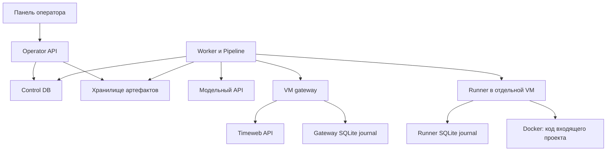

# Архитектура v2c

v2c принимает снимок проекта, согласует план изменений, выполняет его в отдельной VM и собирает проверяемую поставку. Этот документ описывает владельцев поведения в текущем коде. Порядок чтения: эта карта, нужная строка в [руководстве изменений](change-guide.md), затем исходник и его тесты. Решение сохранить процессные и транзакционные границы записано в [ADR 0001](decisions/0001-preserve-process-and-state-boundaries.md).

## Процессы и данные

API и worker — отдельные процессы. API принимает короткие запросы; [worker](../src/v2c/worker.py) получает claim, поддерживает lease и вызывает Pipeline. Код входящего проекта исполняется runner в VM, а не API/worker. Настройки и сборка зависимостей находятся в [config.py](../src/v2c/config.py); способы развёртывания — в [deployment.md](deployment.md) и [timeweb.md](timeweb.md).

Control DB хранит проекты/метаданные, snapshots, runs, steps, attempts, plans, approvals, команды, свидетельства, указатели артефактов, usage и events. Модель схемы — [models.py](../src/v2c/models.py), изменения схемы — [Alembic](../migrations/versions). SQLite пригоден для локальных проверок; конкурентное поведение PostgreSQL проверяется отдельно. Это не взаимозаменяемое доказательство корректности блокировок.

[ArtifactStore](../src/v2c/storage.py) хранит байты архивов, checkpoints и поставок локально или в S3. В DB находятся ключ, SHA-256, размер и метаданные; запись в object storage и транзакция DB не образуют общей распределённой транзакции. Импорт сначала сохраняет байты и только потом публикует snapshot. Проверка чтения связывает байты с сохранёнными хешем и размером.

Runner и gateway владеют собственными SQLite-журналами, а не control DB. В них сохраняются принятые команды и облачные намерения, необходимые после рестарта. Формат, версия и правила восстановления принадлежат соответствующему процессу.

## Владельцы поведения

| Участок | Где читать и менять | Граница ответственности |
|---|---|---|
| HTTP и доступ оператора | [api.py](../src/v2c/api.py), [contracts/operator.py](../src/v2c/contracts/operator.py) | Auth/owner check, входные и выходные DTO, статические файлы, HTTP-ошибки. Схемы полей не выводятся из ORM автоматически |
| Импорт и человеческий handoff | [application/imports.py](../src/v2c/application/imports.py), [application/handoff.py](../src/v2c/application/handoff.py) | Прикладной порядок операций; caller проверяет владельца до вызова |
| Переходы и атомарные guards | [engine.py](../src/v2c/engine.py), [workflow/states.py](../src/v2c/workflow/states.py) | Engine координирует транзакции run/step/attempt; states содержит раздельные состояния и чистые правила completion/retry |
| Общая транзакция | [persistence/unit_of_work.py](../src/v2c/persistence/unit_of_work.py) | Runtime lock, текущая attempt/generation, запись события и освобождение активного run |
| Метаданные, команды, свидетельства, учёт | [metadata.py](../src/v2c/persistence/metadata.py), [commands.py](../src/v2c/persistence/commands.py), [evidence.py](../src/v2c/persistence/evidence.py), [usage.py](../src/v2c/persistence/usage.py) | Запросы и записи через общий ControlDatabase; без model/HTTP/VM вызовов |
| Этапы преобразования | [pipeline.py](../src/v2c/pipeline.py) | Явный реестр `inspect`, `baseline`, `plan`, `transform`, `verify`, `package`, `ai_handoff` и последовательность операций каждого этапа |
| Намерения и внешний эффект | [orchestration/journal.py](../src/v2c/orchestration/journal.py), [execution.py](../src/v2c/orchestration/execution.py) | Стабильные IDs, guards, dispatch/readback, lifecycle VM, cancel и reconciliation |
| Модель и её контекст | [orchestration/model.py](../src/v2c/orchestration/model.py), [schemas.py](../src/v2c/orchestration/schemas.py) | Ограничение контекста, типы ответов, долговечная идентичность модельной операции |
| Исходники и поставка | [intake.py](../src/v2c/intake.py), [delivery.py](../src/v2c/delivery.py), [orchestration/sources.py](../src/v2c/orchestration/sources.py), [archive.py](../src/v2c/orchestration/archive.py), [handoff.py](../src/v2c/orchestration/handoff.py) | Безопасный импорт/Git, checkpoints, ZIP, manifest, запечатывание точного принятого digest |
| Порты и адаптеры | [contracts/ports.py](../src/v2c/contracts/ports.py), [contracts/workflow.py](../src/v2c/contracts/workflow.py), [adapters/model.py](../src/v2c/adapters/model.py), [adapters/runner.py](../src/v2c/adapters/runner.py) | Внутренние TypedDict/Protocol отдельно от HTTP DTO; ModelPort и ArtifactStore сохраняют свои интерфейсы |
| Изолированное исполнение | [runner](../src/v2c/runner), [runner-protocol.md](runner-protocol.md) | API, admission/fencing, журнал, Docker backend, настройки и безопасная распаковка разделены внутри процесса |
| Cloud lifecycle | [providers/timeweb](../src/v2c/providers/timeweb) | API, gateway service, HTTP-клиент, журнал и сеть; проверка принадлежности ресурса перед удалением |
| Панель | [web](../src/v2c/web) | `api-client.js` — HTTP; `state.js` — выбор/состояние; `polling.js` — обновление; `render.js` — DOM; `panel.js` — сборка |
| Диагностика | [diagnostics.py](../src/v2c/diagnostics.py) | Класс ошибки, известные IDs и расположение кадров приложения; без текста исключения, locals, токенов и исходников проекта |

`Engine` и `Pipeline` остаются действующими координаторами, а не пустыми фасадами. [runner_service.py](../src/v2c/runner_service.py) и [timeweb_gateway.py](../src/v2c/timeweb_gateway.py) сохраняют прежние импорты и `python -m` entrypoints. Календарный срок удаления совместимости не установлен; для каждого фасада нужны следующие подтверждения:

| Совместимость | Условие удаления |
|---|---|
| `v2c.runner_service` | [systemd unit](../deploy/timeweb/v2c-runner.service), [renderer](../deploy/timeweb/render_runner.py), [bootstrap](../deploy/timeweb/bootstrap.py), тесты и известные внешние потребители переведены на замену; проверены запуск CLI с прежними аргументами и чтение существующего runner journal; активные и rollback-образы не требуют старого пути |
| `v2c.timeweb_gateway` | Команда [Compose](../compose.yaml), renderer, тесты и известные внешние потребители переведены на замену; проверены запуск gateway с прежними настройками, чтение journal и сохранение pending create/delete/firewall intents; развёрнутые и rollback-конфигурации больше не вызывают старый модуль |
| Re-exports и методы совместимости `Engine`/`Pipeline` | Составлен перечень использующих их импортов/вызовов, все поддерживаемые потребители переведены на явный API; контрактные и persisted identity fixtures проходят без смены ID, hash или wire-формы. Удаление отдельных alias не означает удаления самих координаторов |

Отсутствия импортов в одном checkout недостаточно: точки запуска уже установленных VM и поддерживаемый путь отката тоже должны быть проверены. Удаление оформляется отдельным изменением совместимости, а не уборкой после переноса файлов.

## Атомарность и инварианты

1. В control DB один активный run. Захват runtime lock, выбор шага, увеличение attempt/generation и событие начала фиксируются одной транзакцией. Несколько worker не дают разрешения параллельно исполнять разные runs.
2. Проверка lease/generation и защищённая запись выполняются в одной транзакции. Новый модуль persistence не должен превращать их в независимые commits. Истечение lease само по себе не доказывает прекращение внешнего исполнения.
3. Намерение сохраняется до внешнего вызова. Повтор использует ту же идентичность и проверяет совпадение запроса; потерянный ответ требует readback. `UNKNOWN` сохраняет неопределённость и не означает разрешения повторить эффект.
4. HTTP/model/VM вызовы выполняются вне транзакции control DB. После внешнего результата запись снова проверяет fencing. Удалённый stop/destroy должен быть подтверждён до завершения соответствующего перехода.
5. Run, step, attempt, control command и runner wire status имеют разные словари состояний. Например, control `STOPPED` нельзя механически добавлять в terminal runner states.
6. План согласуется для конкретной revision и snapshot; transformation ограничен утверждёнными путями и проверками. Лимит пяти attempts относится к логическому шагу, включая восстановление после отказов.
7. `READY` требует свидетельств для точного `final_digest`, завершённой работы и запечатанного bundle с актуальными receipt IDs. Один успешный тест, человеческий ответ или загрузка ZIP не заменяют эти guards. Запечатывание меняет метаданные, сохраняя принятый код.
8. Типы и Pydantic не должны пересчитывать persisted hashes, добавлять defaults в старые подписанные payloads или объединять отсутствующее поле с `null`. Совместимость формы данных проверяется отдельно от статических типов.

## Проверяемое направление зависимостей

[check_architecture.py](../scripts/check_architecture.py) запрещает runtime-циклы; `contracts` зависит только от своего слоя, `workflow` — от workflow/contracts. Persistence не импортирует API, Engine, Pipeline, orchestration, application, config, адаптеры, runner и providers. Runner/Timeweb provider не импортируют control-plane ORM или control services. `TYPE_CHECKING`-импорты учитываются отдельно от runtime-зависимостей.

Это конкретные ограничения текущего дерева, а не обещание полной изоляции каждого файла. Например, orchestration использует Engine, а transport DTO runner пока живут в adapters/runner.py. Новую абстракцию следует вводить для реальной границы и потребителя, а не для выравнивания дерева каталогов.

Результаты автоматических, интеграционных и live-проверок фиксируются в [verification.md](verification.md). Успех этих проверок не подтверждает человеческий gate M10 из [ТЗ](maintenance/specification.md#M10-проверка-человеческой-передачи--обязательный-финальный-gate); продуктовые handoff receipts также не являются свидетельством прохождения M10 для самого v2c.
