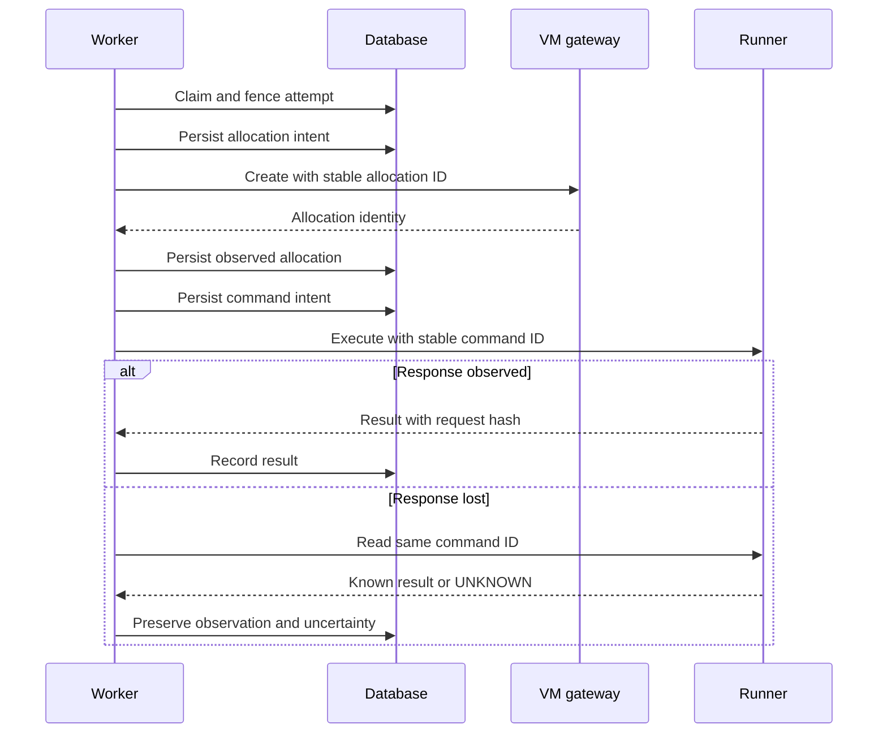
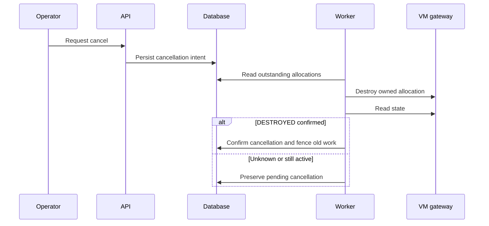

# Workflow ownership and transitions

The workflow is a persisted protocol. File movement must not change IDs,
canonical JSON, counters, NULL values, command effects or transaction boundaries.
The control database owns its single runtime lock; the pipeline calls external
ports only outside a transaction. [Architecture](architecture.md) names owners.

## Separate state vocabularies

`RunStatus`, `StepStatus`, `AttemptStatus` and `CommandStatus` are distinct in
[`workflow/states.py`](../src/v2c/workflow/states.py). Runner wire states are
defined by `adapters/runner.py`; their terminal values do not include every
control-plane observation. In particular STOPPED/DESTROYED must not be copied
into the runner wire schema just to share an enum.

| Input / event | Guards | Atomic result / effect |
|---|---|---|
| QUEUED run, PENDING step / claim | Runtime lock available, attempts < 5, current plan approved where required | Acquire lock; increment attempt/generation; RUNNING run/step and ACTIVE attempt; event |
| ACTIVE attempt / successful finish | Current lease/generation, terminal command observations, no pending reconciliation | Step SUCCEEDED; run QUEUED if pending work else AWAITING_HANDOFF; release lock; event |
| ACTIVE attempt / retryable failure | Reason permits retry; attempts < 5 | Step PENDING, run QUEUED; preserve reason; release lock |
| Failure / exhausted fifth attempt | Retryable reason, attempts >= 5 | Step/run FAILED; RETRY_LIMIT_EXHAUSTED and original reason |
| Failure / missing input class | AUTH, INVALID_CONFIG, ACCESS_DENIED or MISSING_INPUT under existing completion policy | WAITING step and NEEDS_INPUT run; no guessed success |
| Active work / explicit wait | Run wait status allowed and no unresolved external commands | WAITING attempt/step; release lock; save reason/details |
| NEEDS_INPUT / resume | No cancellation request | WAITING steps PENDING; run QUEUED; no replacement of immutable attempt history |
| AWAITING_PLAN_APPROVAL / approve | Exact project/snapshot/revision; stable work identities/order | Record one decision; prepare approved work; run QUEUED |
| Plan decision / reject | Same identity checks | Record decision; NEEDS_INPUT with PLAN_REJECTED |
| Expired ACTIVE attempt / recover | Lease expired; run recoverable | Same attempt, new generation, reconciliation required; no automatic second dispatch |
| Run / cancel request | Existing engine terminal/idempotency rules | Record cancellation intent; not proof of remote termination |
| Cancel / confirmed termination | Positive readback of stop/destruction | Attempt CANCELLED, commands STOPPED as applicable, generation advanced, run CANCELLED; release lock |
| AWAITING_HANDOFF / complete | No unfinished/failed work; same digest; latest four PASS receipts and matching sealed bundle | READY for that exact package only |
| READY / new required receipt | Same final digest | Return to AWAITING_HANDOFF; prior sealing is stale |

The table is a guide to actual code, not a second executable DSL. Guards and
atomic writes remain in [`engine.py`](../src/v2c/engine.py),
[`persistence/unit_of_work.py`](../src/v2c/persistence/unit_of_work.py),
[`persistence/commands.py`](../src/v2c/persistence/commands.py),
[`persistence/evidence.py`](../src/v2c/persistence/evidence.py).
Pure completion decisions are in `workflow/states.py`. Tests cover both legal
and forbidden transitions, repeated decisions and rollback of partial writes.

## Plan approval

```mermaid
sequenceDiagram
    participant W as Worker / Pipeline
    participant E as Engine / control DB
    participant A as Operator API
    participant O as Operator
    W->>E: Publish plan revision for snapshot with current fence
    W->>E: Set AWAITING_PLAN_APPROVAL and release runtime lock
    O->>A: GET plan
    A->>E: Read plan after owner check
    E-->>A: Snapshot ID, revision and plan
    A-->>O: Current plan
    O->>A: POST decision with snapshot, revision and approved
    A->>E: Decide after owner check
    Note over E: One transaction: validate identity, status and cancellation
    alt Same decision already recorded
        E-->>A: Current run; no duplicate work or event
    else New approval
        E->>E: Check stable work IDs and order; preserve attempt budgets
        E->>E: Record decision, prepare steps, QUEUED, release lock, event
    else New rejection
        E->>E: Record decision, NEEDS_INPUT / PLAN_REJECTED, release lock, event
    end
    A-->>O: Current run or controlled conflict
    W->>E: Claim approved pending work with a new attempt fence
```

[`publish_plan` and `set_waiting`](../src/v2c/pipeline.py) are separate fenced
transactions; publication alone does not authorize execution. In
[`decide_plan`](../src/v2c/engine.py), stale snapshot/revision, conflicting
repeat decisions and invalid work identities fail without partially committing
an approval. The final claim shown applies to approved work only; claiming a
transform step rechecks approval of the current revision. A title change does
not reset counters, and an empty approved work list creates verification work.

## Dispatch and lost response



After process restart, generation fences old producers before reconciliation.
An absent/unknown runner result is not permission to execute a new command.
An unknown generic model call preserves unknown cost/delivery and waits for a
decision; a new paid call is not an implicit retry.

## Cancel and recovery



Do not manually set CANCELLED/READY or release the global slot to unstick a
run. See [operations](maintenance/operations.md) for the supported diagnostic
path. The single-active-run rule is preserved; throughput scaling is outside
this refactor.

## Final handoff

```mermaid
sequenceDiagram
    participant O as Operator
    participant A as API / handoff application
    participant E as Engine / control DB
    participant S as HandoffSealer
    participant B as ArtifactStore
    O->>A: POST human outcome, evidence and final digest
    A->>E: Check owner, allowed waiting state and matching digest
    A->>E: Commit human receipt with actor and evidence
    alt Human outcome is FAIL
        A-->>O: Current run; no seal or READY transition
    else Human outcome is PASS
        A->>S: Seal exact final digest
        S->>E: Read run, work, latest required receipts and bundle pointers
        Note over S: Require all four latest PASS receipts for this digest
        alt Matching sealed bundle already exists
            S-->>A: Existing sealed artifact
        else Candidate needs sealing
            S->>B: Read candidate and verify bytes, hash, size and manifest
            S->>B: Write sealed ZIP; accepted code remains unchanged
            S->>E: Record sealed artifact and exact receipt IDs
            S-->>A: Sealed artifact
        end
        A->>E: Complete handoff in one locked transaction
        Note over E: Recheck work, cancellation, digest, latest PASS receipts and seal
        E->>E: READY, release runtime lock, HANDOFF_READY event
        E-->>A: READY run
        A-->>O: READY run
    end
```

Final verification uses a fresh VM; package creation produces a candidate.
The held-out AI exercise is not silently included in delivered product code.
The human receipt binds its outcome to the candidate's final digest. The
handoff sealer includes exactly the latest required receipt identities and
the engine checks that seal before READY. Changing a required receipt
invalidates the old seal.

The [application](../src/v2c/application/handoff.py) records the receipt before
calling the [sealer](../src/v2c/orchestration/handoff.py). These writes and object
storage are not one transaction: a seal failure may leave a committed receipt,
and a failed final guard may leave a stored artifact without READY. The final
[`complete_handoff`](../src/v2c/persistence/evidence.py) check rejects a stale
seal if receipts changed in the meantime. Its failure returns a controlled
error instead of the READY response shown on the successful path.

Sealing performs no model or runner calls and invents no acceptance evidence.
Remote execution and stop/destroy outcomes must already have real readback
recorded by the workflow; an uploaded receipt cannot substitute for it.
The application also accepts a human receipt while NEEDS_INPUT, but the sealer
still requires AWAITING_HANDOFF (or READY internally); a PASS receipt does not
bypass that guard. See [human acceptance](maintenance/human-acceptance.md)
for acceptance of the v2c refactor itself (a separate exercise).

## Regression evidence

- Existing engine/pipeline/acceptance tests preserve behavior and retry budgets.
- `tests/test_workflow_contracts.py` checks pure decision boundaries and atomic rollback.
- `tests/test_maintenance_acceptance.py` compares actual operator API responses
  with immutable baseline fixtures from `bea8639`.
- `tests/test_api_contracts.py` checks schema semantics and generated freshness.
- Journal tests include legacy data and uncertain effects, not only empty DB creation.

Every protocol change must update these sequences and affected test expectations
through an explicit behavior decision. A file split by itself has no contract delta.
